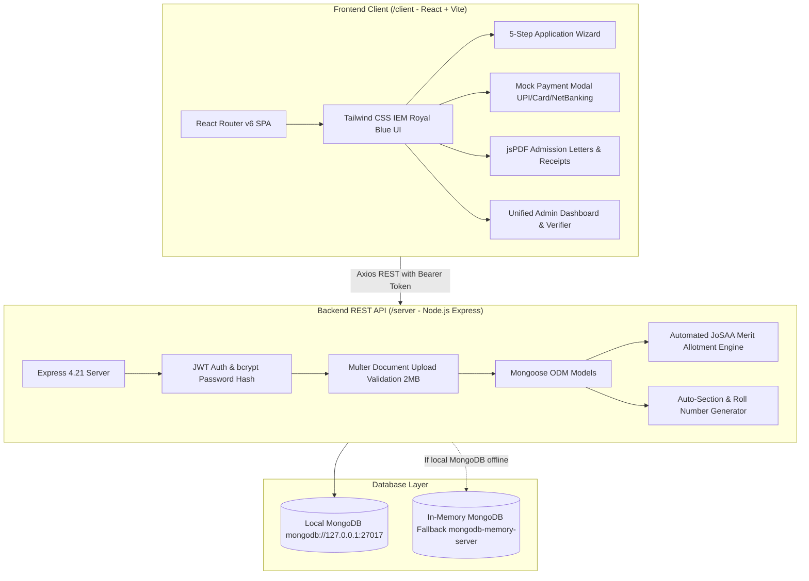

# IEM University Admission & Student Management System (Full-Stack MERN)

> **Course**: 5th-Semester Software Engineering (`PCCCS504`)  
> **Institution**: Institute of Engineering & Management (IEM), Kolkata — Department of CSE  
> **Team**: Team DevSphere  
> **Architecture**: Monorepo Full-Stack MERN (React Vite + Node.js Express + MongoDB)

---

## 🌟 Executive Summary

A production-polished, end-to-end University Admission & Student Management Web Application inspired by **JoSAA counseling** and modern university admission portals. The system encompasses the complete student lifecycle: from registration, OTP mobile verification, and 5-step application submission, through merit rank evaluation, document verification, seat allotment with countdown deadlines, mock payment gateways, automated batch/section generation, semester fee ledgers, and formal admission withdrawal.

---

## 🏗️ Architecture & Technology Stack



- **Frontend (`/client`)**: React 18, Vite 5, Tailwind CSS, React Router v6, Lucide React icons, Axios, `jspdf` & `jspdf-autotable`.
- **Backend (`/server`)**: Node.js, Express.js, JWT (`jsonwebtoken`), Password Hashing (`bcryptjs`), File Uploads (`multer`), Nodemailer Gmail SMTP with strict timeouts, CORS, Dotenv.
- **Database**: MongoDB with Mongoose. Automatically falls back to `mongodb-memory-server` if local MongoDB daemon is not running, ensuring zero downtime during lab evaluation.

---

## 📧 Hybrid Dual-Delivery Notification System (FR-1 & FR-9)

The system supports a **zero-configuration Hybrid Dual-Delivery model**:
1. **Real Gmail SMTP Delivery**: If you supply `GMAIL_USER` and `GMAIL_APP_PASSWORD` in `/server/.env`, the system dispatches real, IEM Kolkata branded HTML emails directly to the applicant's inbox for:
   - 6-Digit OTP Verification Codes (FR-1)
   - Electronic Fee Payment Receipts (FR-9)
2. **On-Screen Simulation Fallback**: If `.env` credentials are empty or if the evaluation network blocks SMTP ports, the system seamlessly falls back in milliseconds without hanging:
   - Displays the OTP in the prominent simulation banner with a **"⚡ Auto-Fill This OTP"** button.
   - Master OTP `123456` is universally accepted for instant lab evaluation.

### How to Enable Real Gmail SMTP (Optional):
1. In your Google Account: Go to **Security** $\rightarrow$ **2-Step Verification** $\rightarrow$ **App passwords**.
2. Create an App Password (name it "IEM Admission").
3. Add the 16-character code to `/server/.env`:
   ```env
   GMAIL_USER=your_email@gmail.com
   GMAIL_APP_PASSWORD=xxxx xxxx xxxx xxxx
   ```

---

## 🔑 Quick Demo Credentials (Pre-Seeded)

The database automatically seeds on startup (or via `npm run seed`) with 1 Admin and 5 sample candidates demonstrating distinct admission milestones:

| Role / State | Email | Password | Key Feature Demonstrated |
| :--- | :--- | :--- | :--- |
| **Admin Staff** | `admin@iem.edu.in` | `Admin@123` | Full Admin Dashboard, Doc Verification, Sections, Reports |
| **Applicant 1** (Under Review) | `rahul@example.com` | `Test@1234` | **FR-11**: Uploaded docs ready for Admin Verification |
| **Applicant 2** (Not Eligible) | `priya@example.com` | `Test@1234` | **FR-12**: Auto-flagged below cutoff (58% PCM vs 75% cutoff) |
| **Applicant 3** (Shortlisted) | `amit@example.com` | `Test@1234` | **FR-18 & 19**: Live Countdown Timer, Accept Seat, Fee Gateway |
| **Applicant 4** (Admitted) | `sneha@example.com` | `Test@1234` | **FR-13, 14, 15, 17**: Admission Letter PDF, Section, Semester Fees |
| **Applicant 5** (Draft) | `arjun@example.com` | `Test@1234` | **FR-6**: Auto-save resume within 30 days |

> *Tip: The Login page includes one-click "Quick Demo Login" buttons to autofill any of these credentials instantly.*

---

## 📋 SRS Requirements Traceability Matrix

| FR ID | Description | Priority | Implementation Details |
| :--- | :--- | :---: | :--- |
| **FR-1** | Applicant Registration with Email, Mobile & OTP | **High** | Password complexity validator (8+ chars, upper, number, symbol), simulated OTP banner, universal Master OTP `123456`. |
| **FR-2** | 5-Step Application Form | **High** | Wizard: `Personal Details` → `Academic History` → `Course Preferences` → `Documents` → `Review & Submit`. |
| **FR-3** | Document Uploads (PDF/JPG, max 2MB) | **High** | Slots for 10th & 12th Marksheets, ID Proof, Photo, Signature. Server-enforced Multer size & MIME checks. |
| **FR-4** | Mandatory Validation & Inline Error Blocking | **High** | Real-time form validations with descriptive toast & field notifications. |
| **FR-5** | Unique Application ID Generation | **High** | Generates human-readable ID upon submission: `IEM-2026-XXXX`. |
| **FR-6** | Auto-Save Draft (Every 2 Minutes) | **Medium** | Automated client-side timer sync with backend; manual "Save Draft" button with 30-day validity flag. |
| **FR-7** | JoSAA Course Preference Ordering | **High** | Dynamic drag/reorder priority of preferred degree programs (CSE, CSE-AIML, ECE, BCA). |
| **FR-8** | Application Fee Checkout Modal | **High** | Mock Payment Gateway (UPI, Card, NetBanking) with configurable ₹1,500 fee and success/failure simulation. |
| **FR-9** | Automated Receipt & SMS/Email Log | **High** | In-app notification ledger detailing transaction receipt and application reference. |
| **FR-10** | Staff Application Filtering & Search | **High** | Admin filter bar: search by name/ID, status dropdown, course dropdown, and date range. |
| **FR-11** | Document Verification Drawer & Mandatory Rejection Reason | **High** | Admin previews documents and marks `Verified` or `Rejected`. Mandatory modal for rejection reason visible to candidate. |
| **FR-12** | Automated "Not Eligible" Cutoff Flag | **High** | System compares candidate's PCM% in real time against course cutoffs; flags ineligible choices with red badges. |
| **FR-13** | Automated Batch & Section Generation | **Low** | Divides admitted students into sections (`CSE-Sec-A`, `CSE-Sec-B`) based on configurable max strength (e.g. 60). |
| **FR-14** | Student Section & Roll Number Allotment | **Low** | Assigns institutional roll numbers (`IEM2026CSE001`) and roster management. |
| **FR-15** | 8-Semester Fee Payment Gateway | **High** | Complete semester fee ledger with instant mock payment and downloadable tuition receipts. |
| **FR-16** | Permanent Student Account Registration | **High** | Locks candidate profile upon enrollment fee completion and generates matriculation records. |
| **FR-17** | Admission Withdrawal & Refund Calculation | **High** | Irreversible cancellation workflow deducting 10% processing fee and releasing seat back to course quota. |
| **FR-18** | Seat Acceptance & Countdown Timer | **High** | Live countdown timer for shortlisted candidates with seat auto-release upon deadline expiry. |
| **FR-19** | PDF Admission Confirmation Letter Download | **High** | Client-side `jspdf` generation featuring IEM Kolkata seal, candidate credentials, roll number, and fee receipt. |
| **FR-20** | Admin Accreditation Report Exports (CSV & PDF) | **High** | Comprehensive audit exports for Applications Received, Seat Occupancy, and Revenue Collections. |

---

## 🚀 Getting Started & Execution

### 1. Prerequisites
- **Node.js**: v18.x or v20.x installed.
- **MongoDB**: (Optional) Local MongoDB service running on `mongodb://127.0.0.1:27017`. If absent, the application automatically launches an embedded `mongodb-memory-server`.

### 2. Quick Run (Both Client & Server)

From the project root:
```bash
# 1. Install all dependencies across root, server, and client
npm run install:all

# 2. (Optional) Run the full database seed script
npm run seed

# 3. Start both backend (port 5000) and frontend (port 3000) concurrently
npm run dev
```

### 3. Running Individually

**Backend Server**:
```bash
cd server
npm install
npm run dev     # Starts on http://localhost:5000
```

**Frontend Client**:
```bash
cd client
npm install
npm run dev     # Starts on http://localhost:3000
```

---

## 🧪 Evaluation Test Script

1. **Test Admin Verification Workflow (FR-10, FR-11)**:
   - Click **"Admin Staff"** quick demo login.
   - Navigate to **Applications**. Click **"Review"** on *Rahul Sharma* (`IEM-2026-0001`).
   - Preview documents, click **Verify** or **Reject** (enter reason), then click **"Shortlist & Allot Seat"**.
2. **Test Seat Allotment Countdown & Payment (FR-18, FR-19)**:
   - Log out, then click **"Amit Kumar"** quick demo login (`amit@example.com`).
   - Observe the active **Countdown Timer** on the dashboard.
   - Click **"Accept Seat & Pay Enrollment Fee"**, select UPI, click **"Simulate Successful Payment"**.
   - Watch status change to **Admitted**; click **"Download Admission Letter (PDF)"**.
3. **Test Automated Cutoff Eligibility (FR-12)**:
   - Log out, then click **"Priya Patel"** quick demo login (`priya@example.com`).
   - Observe the prominent **Automated Eligibility Flag** (PCM 58% vs 75% cutoff).
4. **Test Section Generation (FR-13, FR-14)**:
   - Log in as **Admin**.
   - Navigate to **Sections**, select **B.Tech CSE**, set max strength to `30`, click **"Auto-Generate Sections & Allot Students"**.
   - Inspect the generated roster with roll numbers (`IEM2026CSE001`).
5. **Test Reports & Audit Exports (FR-20)**:
   - In Admin Portal, navigate to **Reports**.
   - Switch between **Applications**, **Seats**, and **Revenue**.
   - Click **"Export CSV"** and **"Export PDF"** to verify formatted report downloads.

---

## 🏛️ Static Helpdesk & Campus Information
- **Campus**: Institute of Engineering & Management (IEM), Sector V, Salt Lake, Kolkata, West Bengal - 700091
- **Phones**: `+91 33 2357 2995`, `+91 33 2357 2059`
- **Email**: `admissions@iem.edu.in`
- **Office Hours**: Monday–Friday: 10:00 AM – 5:00 PM | Saturday: 10:00 AM – 1:00 PM
